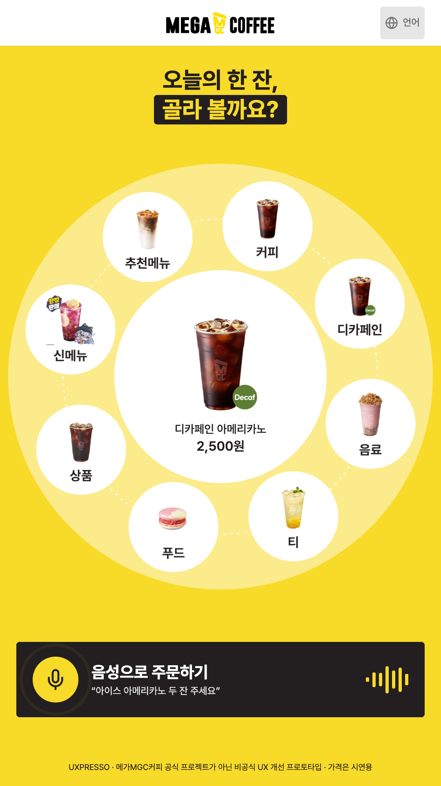
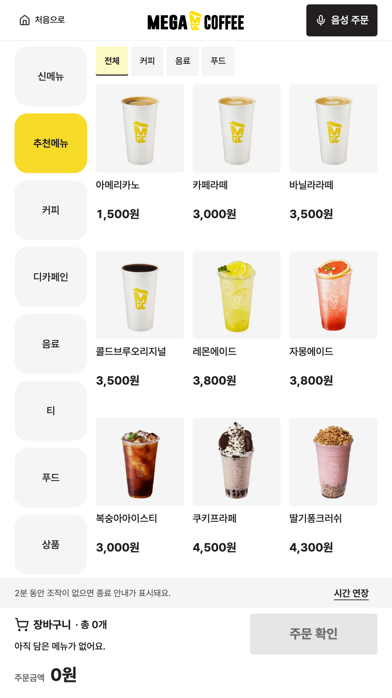
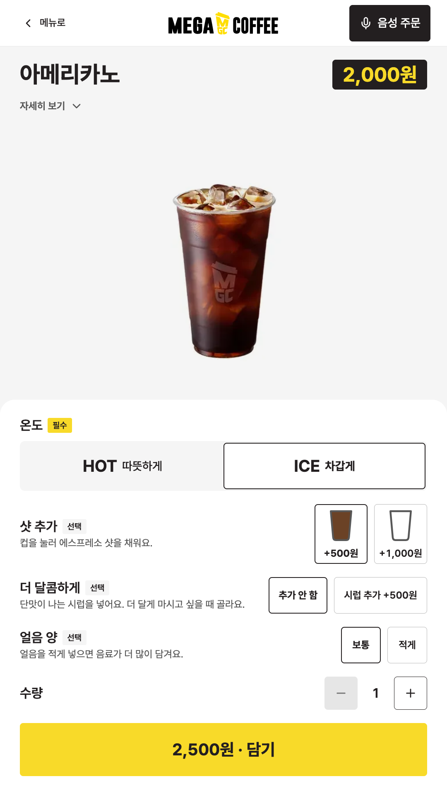
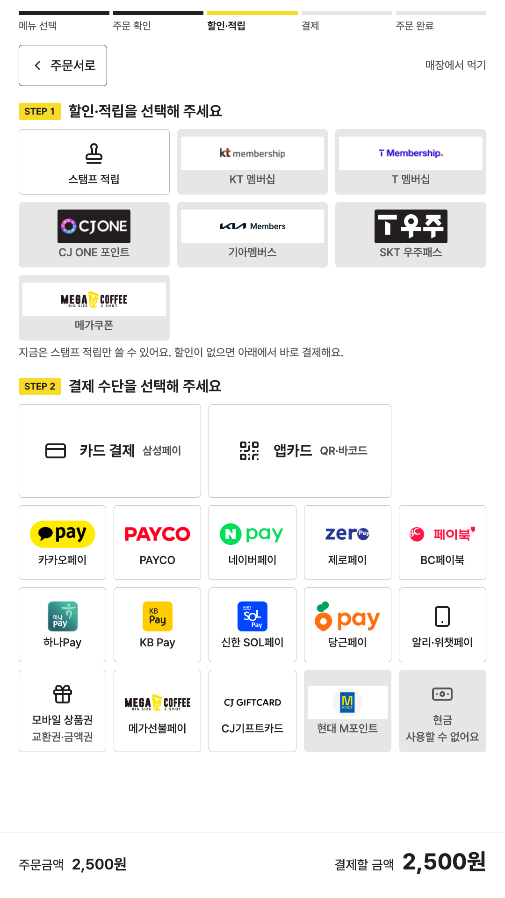

# UXPRESSO — 메가MGC커피 키오스크 UX/UI 개선 (비공식)

> 고민하는 시간을 줄이고, 선택의 확신을 높이다.
> 주문을 서두르게 만드는 키오스크가 아니라, 짧은 시간 안에도 만족스러운 선택을 할 수 있도록 돕는 키오스크.

<p>




</p>

> **비공식 프로젝트입니다.** 메가MGC커피의 공식 프로젝트·디자인 시스템·API가 아니며, 메뉴·가격·쿠폰·결제는 모두 테스트 데이터입니다.

| | |
|---|---|
| 시연 | https://hk06-uxpresso.onrender.com/ (음성 주문은 마이크 권한 필요) |
| Figma | [UXPRESSO 팀 파일](https://www.figma.com/design/RPhFB3P8rftlJ1k0E9QmA7/UXPRESSO--%EC%9C%A0%EC%97%91%EC%8A%A4%ED%94%84%EB%A0%88%EC%86%8C-%ED%8C%80---%EC%B9%B4%ED%8E%98-%ED%82%A4%EC%98%A4%EC%8A%A4%ED%81%AC-%EA%B0%9C%EC%84%A0?node-id=0-1) (Figma 계정 필요) |
| 발표 자료 | [docs/presentation/](docs/presentation/README.md) |
| 문서 목차 | [docs/index.md](docs/index.md) · 제작 과정 [docs/process.md](docs/process.md) |

## 배경과 사용자 문제

PRD에서 정의한 문제는 이렇습니다. 피크타임에 고객이 메뉴 탐색·옵션 이해·주문 방법의 어려움을 스스로 해결하지 못하면 주문이 늦어지고 **심리적 부담**이 생깁니다. 뒤에 기다리는 고객을 의식하면 성급하게 고르거나 주문을 포기할 수도 있습니다. 이 내용은 현장 관찰과 인터뷰로 확인할 **가설**이며, 사용성 테스트는 아직 하지 않았습니다.

UXPRESSO는 세로형(1080×1920) 키오스크에서 이 부담을 줄이는 인터랙티브 프로토타입입니다. 근거: [PRD 원문 Ver. 2.0](docs/archive/prd/prd-v2.0.md) · [리서치](docs/research/README.md) · [페르소나](docs/personas/README.md)

## 핵심 서비스와 차별점

- **SEE 한눈에 발견:** 돌아가는 8개 메뉴가 있는 시작 화면, 카테고리 + 서브메뉴 + 3열 카드
- **UNDERSTAND 직관적 이해:** 행동과 결과가 보이는 버튼 문구, HOT/ICE를 글자와 색으로 함께 표시, 추가 금액 바로 반영
- **DECIDE 확신 있는 선택:** 주문서에서 전체 내역 확인·수정, 결제 전까지 언제든 되돌리기
- **음성 주문 (선택 기능):** "아이스 아메리카노 두 잔" 같은 말로 담기. 서버가 메뉴 데이터로 먼저 검증하고, AI는 **실제 장바구니 결과를 받은 뒤에만** 말합니다. 결제·쿠폰·적립은 음성으로 하지 않으며 터치만으로도 전체 주문이 가능합니다.
- **재촉하지 않는 화면:** 대기 인원·카운트다운 표시 없음. 120초 동안 조작이 없을 때만 종료 안내(60초 유예)

## 주요 사용자 플로우

```
시작 ─┬→ 메뉴 → 상세·옵션 → 주문서(매장/포장) → 할인·적립 + 결제 수단 → 결제 처리 → 완료(주문번호·영수증)
      └→ 음성으로 주문하기 → 같은 장바구니 → 주문서부터 터치로 진행
```

화면별 설명: [docs/prototype/](docs/prototype/README.md)

## UX 리서치와 디자인 프로세스

| 단계 | 한 일 | 결과물 |
|---|---|---|
| 리서치 | 매장 영상으로 AS-IS 주문 플로우 재구성(28화면·8화면), UI Audit, 모바일 앱 레퍼런스 | [research/](docs/research/README.md) |
| 페르소나·기획 | 페르소나 2명·여정 지도, PRD v2.0 → v3.0 | [personas/](docs/personas/README.md) · [prd/](docs/prd/prd-v3.0.md) |
| 디자인 시스템 | 1차 Kit → 2차 DS → **DS v6.0** | [design-system/](docs/design-system/README.md) |
| 프로토타입 | 초기 키오스크 → 시안 v2-I → **키오스크 v6** | [prototype/](docs/prototype/README.md) |
| 음성 주문 | AI Lab 실험 → AI Studio → v6 통합 | [api/ai-integration.md](docs/api/ai-integration.md) |

단계별 자세한 내용: [docs/process.md](docs/process.md) · 이전 디자인과 실험: [docs/archive/](docs/archive/README.md)

## 주요 디자인 의사결정

문서에 기록된 결정만 적었습니다. 근거와 전체 목록은 [디자인 시스템 버전 기록](docs/archive/design-system/README.md#주요-디자인-의사결정-문서에-기록된-것만)에 있습니다.

- 선택 상태는 색만 쓰지 않고 **체크 + 테두리**로 표현
- 새 브랜드 색을 만들지 않고 **승인된 브랜드 값**(#F8DA29·#231F20) 유지 (DS v6.0)
- 챗봇형 자연어 검색·AI 질의응답은 빼고, **허용된 의도만** 기존 화면으로 연결 (PRD v3.0)
- 음성 주문은 선택 기능. 결제·쿠폰·적립은 항상 직접 터치
- 쿠폰 기능은 초기 프로토타입에서 만들었지만 최종 v6에는 넣지 않음 ([기록](docs/archive/deprecated-features/coupons.md))

## 기술 스택

| 영역 | 사용 |
|---|---|
| 화면 | HTML · CSS · 바닐라 JavaScript (빌드 없음), Pretendard, Lucide 아이콘(CDN) |
| 서버 | Node.js 20+ 기본 `http` 모듈, `ws`(WebSocket) |
| 음성 주문 | Google Gemini Live (`@google/genai`), 서버에서만 API 키 사용 |
| 배포 | Render |
| 테스트 | Node 스크립트(가짜 Gemini Live), Playwright 브라우저 E2E |

## 시스템 구조

```
브라우저 (public/v6/)                         서버 (server.js)                      외부
 ├─ app.js  화면·장바구니 ── GET  /api/menus, /api/categories, /api/payment-methods
 │                         ── POST /api/pay, GET /api/pay/:txId  (모의 결제, 같은 key 중복 결제 방지)
 │                              └─ data/*.json (테스트 데이터)
 └─ live-adapter.js ─ live-client.js ══ WebSocket /api/live ══ lib/live-kiosk.js ══ Gemini Live
                                          (lib/live-guard.js: Origin·동시 접속·시간 제한)
                                          (lib/catalog.js: v6 메뉴 데이터로 검증)
                                        GET /api/live/health  (키·모델 상태 확인)
```

API를 불러오지 못하면 `data/` 기본 데이터로 주문을 이어갑니다. 모의 API 목록: [docs/api/](docs/api/README.md)

## 실행 방법

```bash
npm install
```

```bash
npm start
```

http://localhost:3000 이 키오스크 v6(`/v6/index.html`)로 열립니다. Node.js 20 이상이 필요합니다.

| 주소 | 내용 |
|---|---|
| `/` | 키오스크 v6 (현행) |
| `/index.html` · `/?demo=<화면>` · `/screens.html` · `/kit.html` | 초기 프로토타입 · 화면 바로 열기 · 시안 보드 · UI Kit ([보관 안내](docs/archive/prototypes/README.md)) |
| `/api/live/health` | 음성 주문 상태 확인 |

## 환경변수

음성 주문을 쓸 때만 필요합니다. 키가 없어도 터치 주문은 그대로 동작합니다. [`.env.example`](.env.example)에 이름만 있고, 서버는 `.env` 파일을 자동으로 읽지 않으니 실행할 때 직접 넘겨 주세요. **실제 키를 저장소에 올리지 마세요.**

```bash
GEMINI_API_KEY=<키> npm start
```

| 이름 | 필수 | 설명 |
|---|---|---|
| `GEMINI_API_KEY` | 음성 주문 시 | 서버에만 저장. 브라우저로 보내지 않음 |
| `PORT` | 선택 | 기본 3000 |
| `GEMINI_LIVE_MODEL` · `GEMINI_LIVE_VOICE` | 선택 | 모델·목소리 |
| `LIVE_ENABLED` | 선택 | `false`면 음성 주문 끔 |
| `LIVE_ALLOWED_ORIGINS` · `LIVE_MAX_SESSIONS` · `LIVE_MAX_PER_IP` · `LIVE_SESSIONS_PER_HOUR` · `LIVE_MAX_SECONDS` · `LIVE_IDLE_SECONDS` | 선택 | 접속 보호 한도 |

Render 설정: [docs/api/ai-integration.md](docs/api/ai-integration.md#render-배포에-필요한-것-설정은-바꾸지-않았다--안내만)

## 테스트와 검증 결과

모두 **가짜 Gemini Live**로 돌린 자동 테스트입니다. 실제 Gemini 응답 품질, 실제 마이크·스피커, 사용성 테스트는 아직 검증하지 않았습니다.

| 테스트 | 명령 | 결과 (2026-11-26) |
|---|---|---|
| 문법 검사 | `npm run build` | 통과 |
| 서버 테스트 | `npm test` | 85개 통과 / 0개 실패 |
| 브라우저 E2E | `node scripts/e2e-v6.cjs . <스크린샷 폴더>` (Playwright 필요) | 37개 통과 / 0개 실패 |
| 배포 사이트 상태 | `GET /api/live/health` | 응답 정상, 키 설정됨, 모델 Live 지원 (실제 음성 대화는 확인하지 않음) |

자세한 결과: [docs/testing/](docs/testing/README.md)

## 구현 현황

| 상태 | 기능 |
|---|---|
| 완료 | 터치 주문 전체(시작 → 완료), 옵션·수량 규칙, 주문서 수정, 모의 결제(승인·확인 중·실패), 세션 종료 안내, 음성 주문(Gemini Live) 연결과 오류 안내 |
| 진행 중 | 완료 주문 저장(Supabase) — `feature/supabase-orders` 브랜치, 실제 DB 연결·검증 후 통합 예정 |
| 미구현 | 언어 설정(버튼은 "준비 중"), 사용성 테스트, 실제 결제·멤버십 연동 |
| 제외 | 쿠폰 기능, 챗봇형 자연어 검색·AI 질의응답 |

## 팀과 기여

팀: **UXPRESSO**

팀원별 역할은 팀이 직접 적어 주세요. 확인되지 않은 역할은 쓰지 않았습니다.

| 팀원 | 역할 | 주요 작업 |
|---|---|---|
| (작성 필요) | | |

아래는 정리 브랜치 기준 커밋 기록(병합 커밋 제외, 2026-11-26)으로 센 숫자입니다. 기여도를 나타내는 지표는 아닙니다.

| Git 작성자 | 커밋 | 주로 바뀐 곳 |
|---|---:|---|
| designoh | 34 (+ 공동 작성 2) | 리서치, 디자인 시스템, 초기 프로토타입, 키오스크 v6, 발표 자료·DS v6.0(공동 작성) |
| Noh | 3 | 저장소 시작, PRD v3.0·DS v2.0 원문 업로드 (PR #5·#9 병합) |
| Claude (AI 도구) | 21 | 음성 주문 통합, 문서·저장소 정리 — 팀원이 Claude Code로 만든 커밋 |

브랜치에서 가져온 파일은 원래 커밋을 병합하거나 `Co-authored-by`로 원작자를 남겼습니다. 브랜치별 기록: [docs/archive/README.md](docs/archive/README.md)

## 문서

| 보고 싶은 것 | 위치 |
|---|---|
| 전체 문서 목차 | [docs/index.md](docs/index.md) |
| 이전 디자인·프로토타입·브랜치 기록·복구 방법 | [docs/archive/](docs/archive/README.md) |
| 자료 올리는 위치·브랜치 규칙 | [CONTRIBUTING.md](CONTRIBUTING.md) |
| Claude Code 작업 가이드 | [CLAUDE.md](CLAUDE.md) |
