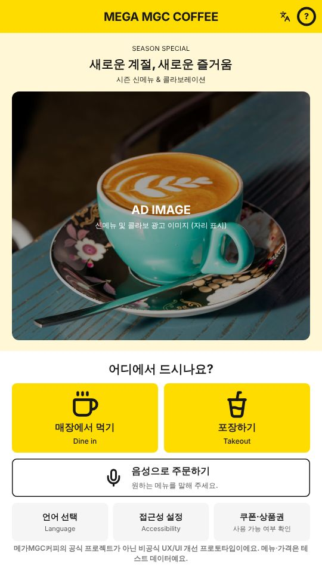
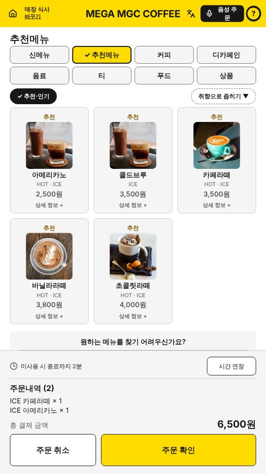
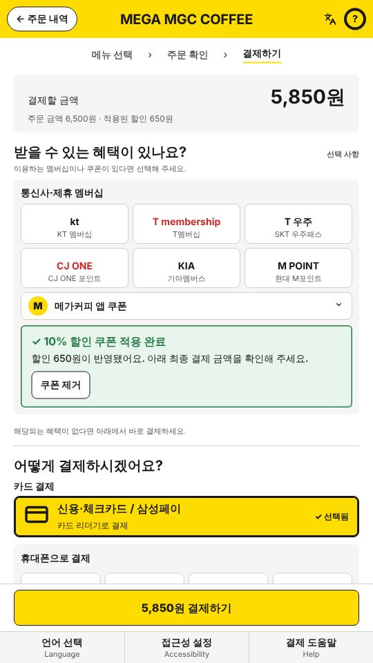
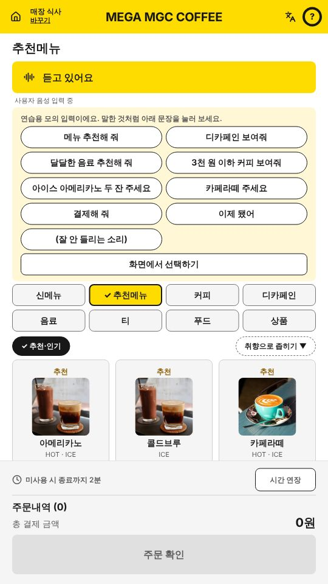
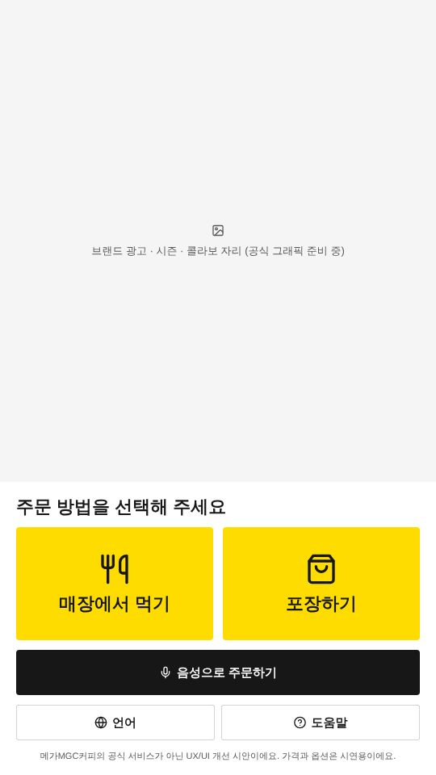
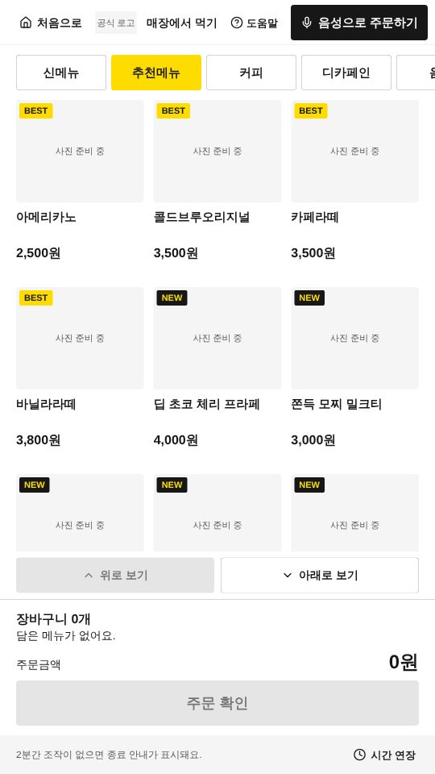

# 이전 프로토타입

현행 서비스는 [키오스크 v6](../../prototype/README.md)입니다. 여기에는 v6에 이르기까지 만든 이전 프로토타입의 대표 화면과 설명만 모았습니다. 실행 코드는 복사하지 않았습니다. 각 항목의 "코드 위치"에서 그대로 실행할 수 있습니다.

> 비공식 프로토타입입니다. 메뉴·가격·쿠폰·결제는 모두 테스트 데이터입니다.

## 초기 키오스크 프로토타입 (v1~v5)

2026-11-25에 만든 첫 키오스크입니다. 주문 흐름 전체, 쿠폰 미리 확인, 결제 오류 복구, 승인 확인 중 상태, 모의 음성 CTA, 단계별 도움말, 540×960 참고 시안 레이아웃까지 구현했습니다.

| 시작 | 메뉴 | 쿠폰·결제 | 모의 음성 |
|---|---|---|---|
|  |  |  |  |

- **코드 위치:** `main`의 `public/index.html` · `public/app.js` · `public/style.css` · `public/kit.html` · `public/screens.html`. 지금도 서버가 그대로 서비스합니다.
  - `/index.html`, `/?demo=<화면>` (예: `/?demo=pay-coupon`), 시안 보드 `/screens.html`, UI Kit `/kit.html`
  - 첫 주소 `/`만 v6로 이동합니다. 이 파일들은 옮기지 않았습니다. v6가 `public/live-client.js`를 함께 쓰고, `npm run build`가 이 경로를 검사하며, 이미 배포된 주소가 바뀌기 때문입니다.
- **디자인 기준:** [2차 디자인 시스템](../design-system/ds-2nd/README.md)
- **상품 사진:** Unsplash 임시 이미지
- **화면 캡처:** 2026-11-26 정리 브랜치에서 서버를 실행해 찍었습니다.

## DS v2 아트보드

Claude Design 캔버스에서 만든 초기 프로토타입용 화면 12장(Main·Menu·Detail·Cart·Confirm·결제 상태들·Help)의 소스 백업입니다. 캔버스 전용 형식(`.dc.html`)이라 단독으로 열면 이미지가 보이지 않습니다.

- 위치: [artboard-ds-v2/](artboard-ds-v2/README.md) (이전 경로 `docs/artboard/`)

## v2-I 앱 (첫 화면 교체안)

v2-I 시안을 앱의 첫 화면(`public/index.html`)으로 서비스하는 안입니다. 시안 자체는 v6의 레이아웃 원본이라 [../../prototype/v2-i/](../../prototype/v2-i/README.md)에 현행 자료로 두었습니다. 첫 화면 교체는 `main`에 반영하지 않았습니다.

- **코드 위치:** 브랜치 `feat/v2-i-prototype-app` (`cf6c887`, PR #11 열림) → 정리 뒤 태그 `archive/feat-v2-i-prototype-app`

## mega-ver.2 재구성

DS v6.0을 바탕으로 `public/` 전체를 다시 만든 별도 안입니다(designoh, 32커밋). 한 줄 카테고리와 세로 스크롤, 단순화한 상품 카드, NEW 배지, 한 화면에 모든 결제 수단, 선택 옵션 외곽선 같은 변경을 담았고, 이를 DS v7.1·PRD v3.1로 문서화했습니다.

| 첫 화면 | 메뉴 |
|---|---|
|  |  |

- **코드 위치:** 브랜치 `mega-ver.2` (`cf9209c`) → 정리 뒤 태그 `archive/mega-ver.2`
- **문서:** [DS v7.1](../design-system/mega-ver2/uxpresso-design-system-v7.md) · [UI Refinement v2.1](../design-system/mega-ver2/refinement-v2.1.md) · [PRD v3.1](../prd/prd-mega-ver2.md)
- **현행 반영:** 문서만 보관했습니다. 화면은 반영하지 않았습니다. 상품 사진 자리의 "사진 준비 중"은 이 안의 원래 표시입니다.
- **화면 캡처:** 2026-11-26 이 브랜치를 그대로 실행해 찍었습니다.
