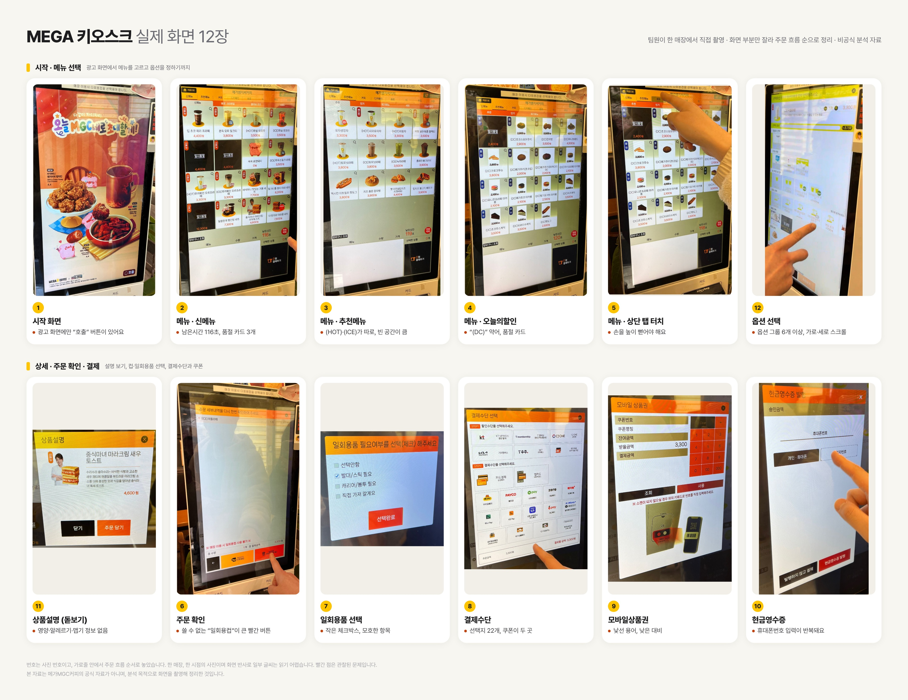

# MEGA 키오스크 AS-IS UI 분석

> 메가MGC커피 키오스크 UX/UI 개선 **비공식** 프로젝트(팀 UXPRESSO)의 현황 분석 문서입니다.
> 메가MGC커피의 공식 자료가 아니며, 팀원이 한 매장에서 직접 촬영한 사진과 직접 이용한 경험을 바탕으로 합니다.

## 0. 조사 개요

| 항목 | 내용 |
|---|---|
| 방법 | 매장 키오스크 사진 12장 + 팀원이 직접 이용해 본 경험 |
| 범위 | 시작 화면 → 메뉴 탐색 → 옵션 → 장바구니 → 주문 확인 → 일회용품 → 결제수단·쿠폰 → 현금영수증 |
| 한계 | **한 매장, 한 시점**의 사진입니다. 매장 설정에 따라 다를 수 있습니다. |
| | 화면 반사로 글씨가 안 보이는 부분이 있습니다(사진 6~10, 12). 읽을 수 없는 부분은 추정하지 않고 "확인 필요"로 표시했습니다. |
| | 주문 완료 화면, 오류 화면, 타이머 만료 시 동작은 촬영하지 않았습니다. |
| | 소요 시간과 터치 수는 아직 측정하지 않았습니다. |

**근거 표기**

| 표기 | 뜻 |
|---|---|
| **[사진 N]** | 사진에서 직접 확인한 것 |
| **[경험]** | 팀원이 직접 이용하면서 알게 된 것 |
| **[가설]** | 근거가 약해 검증이 필요한 것 |



*사진은 키오스크 화면 부분만 잘라 정리했습니다. 사진 번호: 1 시작 화면 · 2 신메뉴 · 3 추천메뉴 · 4~5 오늘의할인 · 6 주문 확인 · 7 일회용품 · 8 결제수단 · 9 모바일상품권 · 10 현금영수증 · 11 상품설명 · 12 옵션 선택*

---

## 1. 실제 주문 흐름 (AS-IS)

```
시작(광고 화면) ─→ 메뉴 탭 이동 ─→ 메뉴 카드 터치 ─→ 옵션 선택 화면 ─→ 주문담기
   [사진 1]        [사진 2~5]                        [사진 12]
                                    (카드의 돋보기 → 상품설명 [사진 11])
        │
        ▼
장바구니(화면 아래) ─→ 결제하기 ─→ 주문 세부내역 확인 ─→ 일회용품 선택 ─→ 결제수단 선택
   [사진 2~5]                      먹고가기/일회용컵       [사진 7]        할인수단 + 결제수단
                                      [사진 6]                              [사진 8]
        │
        ▼
쿠폰·상품권 입력 [사진 9] / 현금영수증 [사진 10] ─→ 카드 결제 ─→ 영수증·주문번호
```

- **먹고가기/포장 선택은 맨 끝**(주문 확인)에 있고, "컵 종류"라는 이름으로 나옵니다. [사진 6]
- 종이 안내(STEP 1~5)에는 "먹고가기 or 포장하기 선택"이 STEP 2로 적혀 있어 **종이와 화면의 순서·이름이 다릅니다.** [사진 1~5 왼쪽]
- 메뉴 카드를 누르면 **옵션 화면**으로 가고, "주문담기"를 눌러야 장바구니에 들어갑니다. [경험]
- 카드 오른쪽 위의 **돋보기**를 누르면 상품설명이 열립니다. [경험, 사진 11]

### 터치 수 추정 (아이스 음료 1잔, 카드 결제, 옵션은 기본값)

| 단계 | 터치 |
|---|---|
| 메뉴 카드 | 1 |
| 옵션 화면에서 주문담기 | 2 |
| 결제하기 | 3 |
| 먹고가기(다회용컵) 선택 | 4 |
| 일회용품 선택 후 선택완료 | 5~6 |
| 결제수단 선택(할인수단 선택이 필수인지 **확인 필요**) | 6~8 |

**약 6~8회(추정)** 입니다. 필수 단계가 정확히 어디까지인지, 시작 화면에서 터치가 더 필요한지는 확인하지 못했습니다. 같은 주문을 직접 해 보고 측정해야 합니다(7장).

---

## 2. 핵심 발견 요약

| ID | 문제 | 근거 | 심각도 | 관련 PRD |
|---|---|---|---|---|
| A-01 | 남은 시간(120초)이 빨간 숫자로 계속 보임. 탭을 옮길 때마다 초기화됨 | [사진 2~5] 116·119·120·118초, [경험] | 높음 | P-06 |
| A-02 | 먹고가기/포장이 맨 끝에 "컵 종류"로 나옴. 쓸 수 없는 선택지가 큰 빨간 버튼 | [사진 6] | 높음 | Problem 02 |
| A-03 | 결제수단 화면에 선택지 22개가 같은 비중으로 있고, 쿠폰이 두 곳에 흩어짐 | [사진 8] | 높음 | Problem 03 |
| A-04 | 주문 중 도움·호출 버튼이 보이지 않음 | "호출"은 [사진 1]에만, [사진 2~5·12]에는 없음 | 높음 | P-04, P-05 |
| A-05 | 메뉴 이름·표기가 어려움. (HOT)/(ICE)가 별개 카드, "(DC)" 같은 약어 | [사진 2~5] | 중간 | P-01, P-02 |
| A-06 | 옵션 화면이 길고 복잡함. 옵션 그룹 6개 이상, 가로·세로 스크롤 | [사진 12] | 높음 | P-03 |
| A-07 | 메뉴를 알아볼 정보가 부족하고, 상세 보기(돋보기)는 찾기 어려움 | [경험], [사진 2~5, 11] | 중간 | P-02 |
| A-08 | 품절 카드가 목록에 그대로 있음. 의미를 알 수 없는 카드도 있음 | [사진 2~5] | 중간 | P-01 |
| A-09 | 작은 글씨·낮은 대비. 탭, LANGUAGE, 돋보기, 옵션 이름 | [사진 2~5, 12] | 중간 | 접근성 |
| A-10 | 화면 공간 배분이 비효율적임 | [사진 2~6] | 중간 | P-03 |
| A-11 | 일회용품 선택(체크박스) 항목이 모호하고 작음 | [사진 7] | 중간 | P-02 |
| A-12 | 쿠폰 입력 화면의 용어·대비·안내 위치 | [사진 9] | 중간 | Problem 03 |
| A-13 | 휴대폰번호 입력이 반복되고, 입력 화면이 비어 보임 | [사진 10], 종이 STEP 4 | 낮음~중간 | P-03 |
| A-14 | 버튼 색의 의미가 일관되지 않음 | [사진 6~12] | 중간 | 디자인 시스템 |
| A-15 | 화면이 스스로 설명하지 못해 스티커·종이 안내에 의존함 | [사진 1~5] | 중간 | P-04 |
| A-16 | 화면 반사로 글씨가 안 보임 | [사진 6~10, 12] | 확인 필요 | 접근성 |

---

## 3. 화면별 분석

### 3.1 시작 화면 [사진 1]

**관찰**
- 광고 이미지("오늘 MGC네로 초대할게")가 전체 화면을 차지합니다. 신메뉴 소개가 중심입니다.
- 오른쪽 아래에 "호출" 버튼이 있습니다. **주문 화면에는 이 버튼이 보이지 않습니다.**
- 시작하는 방법을 알려 주는 문구는 보이지 않습니다(광고 화면 상태).
- 기기 위와 옆에 스티커·종이 안내가 많습니다("매장 이용시 다회용컵을 선택해야 합니다" 등).

**문제**
- 호출 버튼이 광고 화면에만 있어서, 주문 도중 막혔을 때 쓸 수 없습니다. (A-04)
- 종이 안내가 없으면 순서를 알 수 없는 구조입니다. (A-15)

### 3.2 메뉴 탐색 [사진 2~5]

**관찰**
- 위쪽에 상위 탭 8개(신메뉴, 추천메뉴, 커피, 디카페인, 음료, 티, 푸드, 상품)와 하위 탭이 있습니다.
- 한 화면에 카드가 12~15개이고, 각 카드에는 이미지·이름·가격이 있습니다.
- **같은 메뉴가 (HOT)/(ICE) 두 카드**로 나뉩니다. ((HOT)매실 모과차 / (ICE)매실 모과차 등)
- 오늘의할인 탭은 이름에 **"(DC)"** 가 붙습니다.
- 신메뉴 12개 중 3개, 오늘의할인 15개 중 1개가 "일시품절"입니다. "꼭꼭 숨었돼지 0원"이라는 카드도 있습니다.
- 세트 메뉴 이름이 "내 맘대로 마라클 세트", "달콤한게 땡긴당 세트"처럼 재미있지만 구성을 알 수 없습니다.
- 카드 오른쪽 위에 작은 돋보기가 있습니다.
- 맨 아래 장바구니 영역은 **비어 있어도 화면의 약 1/4**을 차지합니다. 사진 3은 메뉴 아래에도 빈 공간이 큽니다.
- 오른쪽 아래에 "남은시간 116초"가 빨간색으로 보입니다.

**문제**
- (HOT)/(ICE)가 카드를 늘려서 같은 메뉴를 두 번 훑어야 합니다. 정도현에게는 반복 탐색(A-05), 이미경에게는 "온도가 옵션이 아니라 다른 메뉴"라는 혼란입니다.
- 품절 카드가 목록 중간에 있어서 눌러도 소용없는 자리가 생깁니다. (A-08)
- 상단 탭은 주황 바탕의 작은 글씨입니다. 선택한 탭은 얇은 밑줄로만 표시됩니다. (A-09)
- 위쪽 탭을 누르려면 손을 높이 뻗어야 하고, 손이 화면을 가립니다. [사진 5] 설치 높이는 확인이 필요합니다.

### 3.3 타이머 [사진 2~5, 11]

**관찰**
- "남은시간 116·119·120·118초"가 빨간 숫자로 계속 표시됩니다. [사진 2~5]
- **메뉴 탭을 옮길 때마다 120초로 초기화됩니다.** [경험]
- 상품설명 팝업 뒤에서도 "남은시간 11…"이 계속 보입니다. [사진 11]

**문제**
- 일정 시간 입력이 없으면 처음으로 돌아가는 기능을 **숫자로 계속 보여 줘서** "서둘러야 한다"는 신호가 됩니다. (A-01)
- 시간이 다 되면 장바구니가 비워지는지, 경고가 뜨는지는 **확인하지 못했습니다.** 확인이 필요합니다.

### 3.4 메뉴 카드 → 옵션 선택 [사진 12]

> 반사가 심해서 일부만 읽을 수 있습니다. 읽은 범위만 적습니다.

**관찰**
- 메뉴 카드를 누르면 이 화면으로 이동합니다. [경험]
- 위쪽에 "선택하신 상품의 옵션상품을 모두 선택해주세요"라는 안내가 있습니다.
- 메뉴 이름 "(ICE)곡물라떼", 한 줄 설명("곡물에 우유가 더해져 고소하게 즐길 수 있는 음료"), 수량(−/+), 가격 3,300원이 있습니다.
- "선택된 옵션" 줄과 "초기화" 버튼이 있습니다.
- 옵션 그룹이 **6개 이상**입니다: 텀블러 선택, 우유 변경, 논-커피 샷 선택, 당도 선택, 토핑 선택, 토핑 선택(같은 이름이 두 번).
- 옵션은 작은 타일이고 가격 차이(+500원, +700원, +1,000원, +1,200원, +2,000원 등)가 작은 글씨로 있습니다.
- "옆으로 넘겨보세요"라는 안내가 있습니다. 즉 **세로 스크롤 안에 가로 스크롤이 있습니다.**
- 옵션 중에도 "일시품절"이 있습니다.
- 아래 오른쪽에 "주문담기" 버튼이 있고, 사진에서는 **흐리게 보입니다.** 비활성인지 반사 때문인지 확인이 필요합니다.
- 주문담기를 누르면 장바구니에 들어갑니다. [경험]

**문제**
- "모두 선택해주세요"라고 하지만 샷·토핑 같은 옵션은 선택 사항이라, **필수와 선택의 구분이 없습니다.** (A-06)
- 음료 한 잔을 기본값으로 시켜도 **이 화면을 거쳐야** 합니다. 목적형 고객에게 불필요한 화면 전환입니다.
- 가로·세로 두 방향으로 스크롤해야 해서 숨은 옵션을 놓치기 쉽습니다.
- 그룹 이름이 작은 세로 글씨이고, "토핑 선택"이 두 번 나옵니다.
- 이 화면에 한 줄 설명이 있어서, 카드를 누르는 순간 **무슨 음료인지 모른 채 담기는 일은 없습니다**(음료 기준). 다만 설명이 작고 연한 글씨입니다.

### 3.5 상품설명 (돋보기) [사진 11]

**관찰**
- 이미지, 이름, 소개 문구, 가격 4,600원, 버튼 2개(닫기 / 주문 담기)가 있습니다.
- 소개 문구는 "수리수리 중마수리~ 바삭한 식빵과…"로 홍보 문구입니다.
- 작은 회색 글씨가 **단어 중간에서 줄바꿈**됩니다("소/스", "중식마/녀").
- **영양·알레르기·원재료·맵기 정보가 없습니다.** "마라크림"인데 맵기 표시가 없습니다.
- 닫기 수단이 오른쪽 위 X와 아래 "닫기" 버튼으로 **두 개**입니다.
- 가격과 버튼 사이에 큰 빈 공간이 있습니다.
- 이미지는 홍보 모델 사진이 크고 음식이 작습니다.

**문제**
- 돋보기는 작고 이름이 없어서 **잘 누르지 않게 됩니다.** [경험] 눌러도 홍보 문구뿐이라 얻는 정보가 적습니다. (A-07)
- 알레르기·영양 정보가 없는 점은 안전과 관련이 있어서 중요합니다.

### 3.6 주문 세부내역 확인 [사진 6]

**관찰**
- "주문 세부내역을 다시 한번 확인하여 주세요"에 메뉴 1건이 있고, 나머지는 큰 빈 공간입니다.
- 빨간 글씨 경고: **"※ 매장 이용 시 일회용컵 사용 불가 ※"**
- 버튼 3개: 뒤로(검정 화살표) / **먹고가기(다회용컵)**(주황) / **일회용컵(매장이용 불가함)**(빨강)
- 핵심 버튼들이 화면 맨 아래에 모여 있습니다.

**문제**
- **먹고가기/포장 선택이 "컵 종류"로 바뀌어 있습니다.** "일회용컵"이 곧 "포장"이라는 걸 알아야 합니다. (A-02)
- **쓸 수 없는 선택지를 큰 빨간 버튼으로** 보여 줍니다. 눌러도 되는지 헷갈리고, 빨강은 보통 경고나 취소를 뜻합니다.
- 이 선택이 주문의 맨 끝이라서, 메뉴를 다 고른 뒤에야 알게 됩니다. [경험] 앞에서 먼저 고르는 게 낫다는 것이 팀의 판단입니다.

### 3.7 일회용품 선택 [사진 7]

**관찰**
- 제목: "일회용품 필요여부를 선택(체크) 해주세요"
- 체크박스 4개: 선택안함 / 빨대·스틱 필요(체크됨) / 캐리어·봉투 필요 / 직접 가져 갈게요
- 빨간 "선택완료" 버튼이 있습니다.

**문제**
- 체크박스가 작아서 정확히 누르기 어렵습니다. (A-11)
- "선택안함"과 "직접 가져 갈게요"의 차이가 모호합니다.
- 체크박스는 여러 개를 고를 수 있는 모양인데 "선택안함"은 다른 항목과 같이 고를 수 없습니다. 어떤 규칙인지 보이지 않습니다.
- 팝업 안에 빈 공간이 많은데 글씨는 작습니다.

### 3.8 결제수단 선택 [사진 8]

**관찰**
- STEP1 "할인수단을 선택해주세요": KT VIP초이스, T멤버십, CJ ONE, 기아멤버스, SKT 우주패스, 메가쿠폰(APP 연동 쿠폰) — **6개**
- STEP2 "결제수단을 선택해주세요": 카드결제, 앱카드, 카카오페이, 페이코, 네이버페이, 제로페이, BC페이북, 알리페이/위챗페이, 하나Pay, KB Pay, 신한 슈퍼SOL, 당근페이, 현대M포인트, 모바일상품권, 메가선불페이, CJ기프트카드 — **16개**
- 모든 선택지가 같은 크기의 카드로 한 팝업에 있습니다.
- 맨 아래에 "결제할 금액: 3,300원"이 빨간 작은 글씨입니다.
- 팝업 아래로 이전 화면의 버튼이 비쳐 보입니다.

**문제**
- **선택지가 22개**이고 추천이나 기본값이 없습니다. 가장 많이 쓰는 "카드결제"가 다른 수단과 같은 비중입니다. (A-03)
- 쿠폰이 **두 곳**에 있습니다: STEP1의 "메가쿠폰 APP 연동 쿠폰"과 STEP2의 "모바일상품권(교환권/금액권)". 어느 쪽을 써야 하는지 알기 어렵습니다.
- STEP1(할인수단)을 건너뛰어도 되는지 알려 주지 않습니다. [확인 필요]
- "카드결제 / 삼성페이"처럼 한 카드에 이름이 둘 붙어 있습니다.
- 쿠폰이 안 되는 경우는 이 단계에서야 알게 될 가능성이 큽니다. [가설]

### 3.9 모바일상품권 입력 [사진 9]

**관찰**
- 입력칸: 쿠폰번호, 쿠폰명칭, 잔여금액, 받을금액(3,300), 결제금액
- 버튼: 조회 / 사용
- 숫자 키패드(빨강)에 영어 "Clear", 00, 000 키가 있습니다.
- 빨간 작은 글씨: "※ 스캔이 되지 않으실 경우 위의 키패드로 번호를 직접 입력해주세요."
- 아래에는 카드 리더에 바코드를 대는 그림이 있습니다.

**문제**
- "잔여금액 / 받을금액 / 결제금액"의 차이를 알기 어렵습니다. (A-12)
- 조회 후 사용이라는 **두 단계**가 필요합니다.
- 입력칸이 올리브색 바탕에 검은 글씨라 대비가 낮습니다.
- 안내 문구는 빨간 작은 글씨이고, 스캔 그림과 떨어져 있습니다.

### 3.10 현금영수증 [사진 10]

**관찰**
- 승인금액, 휴대폰번호 입력, 선택 버튼(개인·휴대폰 / 사업자번호), 아래에 "발행하지 않고 결제"(검정)와 "현금영수증 발행"(빨강)이 있습니다.
- 화면 대부분이 비어 있고 입력칸이 잘 보이지 않습니다.

**문제**
- 종이 안내 STEP 4(스탬프 적립, 핸드폰번호 입력)와 합치면 **휴대폰번호 입력이 반복**됩니다. (A-13)
- "발행하지 않고 결제"는 검정, "현금영수증 발행"은 빨강이라 결제 흐름의 주 버튼이 어느 것인지 헷갈립니다.

### 3.11 공통 [사진 1~12]

- **버튼 색**: 빨강이 가격, 주요 버튼(선택완료, 사용, 현금영수증 발행), 경고, 전체삭제, 불가 선택지에 모두 쓰입니다. 결제 계열의 주요 버튼도 검정("0원 결제하기", "발행하지 않고 결제")과 빨강이 섞여 있습니다. (A-14)
- **헤더 색**: 대부분 주황인데 옵션 화면은 연두색 계열로 보입니다. [사진 12] 사진 노출 때문일 수 있어 확인이 필요합니다.
- **스티커와 종이 안내**: 기기 위의 다회용컵 스티커, 옆의 종이 STEP 1~5, 카드 리더 주변 스티커(일부는 가려지거나 잘려 "로 결제하세요"만 보임)가 있습니다. 화면이 스스로 설명하지 못해서 붙인 보완책으로 보입니다. (A-15)
- **반사**: 화면이 매끄러워서 촬영자와 주변이 비칩니다. 촬영 각도의 영향일 수 있습니다. (A-16)

---

## 4. 잘 된 점

| 항목 | 내용 |
|---|---|
| 주문 내용 재확인 | 결제 전에 한 번 더 확인하는 화면이 있음 [사진 6] |
| 결제수단 단계 표시 | STEP1·2 번호로 순서를 알려 줌 [사진 8] |
| 상태 표시 | 신메뉴·베스트·할인·일시품절 배지가 있음 [사진 2~5] |
| 시각 자료 | 메뉴 사진이 크고 선명함 |
| 음료 설명 | 옵션 화면에 한 줄 설명이 있어 모르는 채로 담기지는 않음 [사진 12] |
| 다양한 수단 | 간편결제·멤버십·쿠폰을 폭넓게 지원 |

---

## 5. 확인이 필요한 것

| 질문 | 왜 중요한가 |
|---|---|
| 타이머가 0이 되면 장바구니는 어떻게 되는가? 경고가 있는가? | 시간 압박의 실제 영향 |
| 옵션 화면의 "주문담기"는 필수 옵션을 안 골라도 눌리는가? | 필수·선택 구분 문제 확인 |
| 카드 본체를 누르면 음식(토스트 등)은 바로 담기는가? | 옵션 없는 메뉴의 흐름 |
| 결제수단 STEP1은 건너뛸 수 있는가? | 터치 수와 혼란 정도 |
| 일회용품 선택은 필수인가? | 터치 수 |
| 주문 완료 화면은 어떤가? 대기 시간·번호 안내는? | 이후 경험 |
| 음료 상세에도 영양·알레르기 정보가 없는가? | 안전 정보 |

---

## 6. 우리 개선안과의 연결

| 발견 | 우리 방향 | 구현 상태 |
|---|---|---|
| A-01 카운트다운 | 카운트다운·대기 인원 표시 금지, 조용한 자동 복귀(`RETURN_MS`) | 구현 |
| A-02 컵 이름의 포장 선택 | "어디에서 드시나요?" 매장에서 먹기/포장하기를 같은 크기로, 시작 단계에서 | 구현 |
| A-03 결제수단 22개 | 쿠폰·결제 수단 미리 확인, 지원되는 수단만 활성화 | 구현(모의) |
| A-04 도움 버튼 없음 | 모든 단계에서 주문 도움·직원 도움 요청 | 구현 |
| A-05 메뉴 표기 | 한 줄 설명 카드, 따뜻하게/차갑게를 옵션으로 | 구현 |
| A-06 복잡한 옵션 | 옵션 통합 배치, 필수·선택 구분, "추가 옵션 없이 장바구니에 담기" | 구현 |
| A-07 숨은 상세 정보 | 카드를 누르면 상세와 옵션이 한 화면, 영양·알레르기는 "보기"로 접음 | 구현 |
| A-08 품절 카드 | 해당 없음 | **새 과제** |
| A-09 작은 글씨 | 터치 영역 최소 88px, 대비 4.5:1 목표 | 기준 있음, 측정 미완 |
| A-10 공간 배분 | 하단 고정 장바구니 | 구현 |
| A-11 일회용품 선택 | 해당 없음 | **새 과제** |
| A-12 쿠폰 입력 | 쿠폰 종류별 조건·방법 안내 | 구현(모의) |
| A-13 번호 입력 반복 | 해당 없음 | **새 과제** |
| A-14 색의 일관성 | UI Kit 버튼 6종, 선택은 색 + ✓ + 테두리 | 구현 |

**새 과제로 남은 것:** 품절 처리(A-08), 일회용품 선택(A-11), 번호 입력 반복(A-13)

---

## 7. 다음 단계

1. **같은 주문을 직접 해서 측정해요.** 아이스 아메리카노 1잔, 카드 결제로 실제 키오스크와 우리 프로토타입(`?debug=1`)에서 터치 수와 시간을 비교합니다.
2. **빠진 화면을 촬영해요.** 주문 완료, 타이머 만료, 옵션 필수 여부, 알레르기 정보.
3. **직원 인터뷰**(PRD 5.3)로 도움 요청 유형을 확인해요.
4. **사용성 테스트**(숙련 3 + 비숙련 3)로 가설을 검증해요.

---

## 8. 사진 목록

| 번호 | 화면 | 파일 |
|---|---|---|
| 1 | 시작(광고) 화면 | `images/as-is/screen-01.jpg` |
| 2 | 신메뉴 탭 | `images/as-is/screen-02.jpg` |
| 3 | 추천메뉴 탭 | `images/as-is/screen-03.jpg` |
| 4 | 오늘의할인 탭 | `images/as-is/screen-04.jpg` |
| 5 | 오늘의할인 탭(손으로 커피 탭을 누르는 모습) | `images/as-is/screen-05.jpg` |
| 6 | 주문 세부내역 확인(컵 선택) | `images/as-is/screen-06.jpg` |
| 7 | 일회용품 선택 | `images/as-is/screen-07.jpg` |
| 8 | 결제수단 선택 | `images/as-is/screen-08.jpg` |
| 9 | 모바일상품권 입력 | `images/as-is/screen-09.jpg` |
| 10 | 현금영수증 발행 | `images/as-is/screen-10.jpg` |
| 11 | 상품설명(돋보기) | `images/as-is/screen-11.jpg` |
| 12 | 옵션 선택 | `images/as-is/screen-12.jpg` |

> **이미지 안내:** 사진은 키오스크 화면 부분만 잘라서 실었고, 다른 손님이 보이는 부분은 제외했습니다. 일부 사진에는 촬영자의 손과 화면 반사가 남아 있습니다. 실제 브랜드 화면을 분석 목적으로 정리한 것이며, 메가MGC커피의 공식 자료가 아닙니다.
