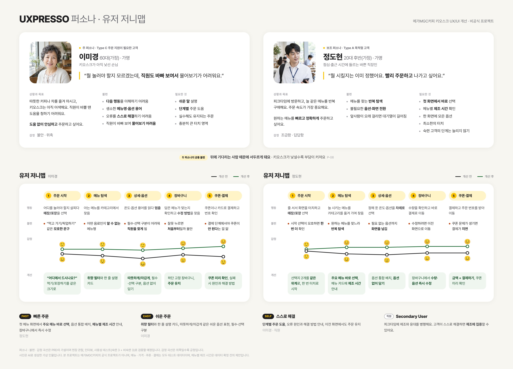

# UXPRESSO 퍼소나

> 메가MGC커피 키오스크 UX/UI 개선 **비공식** 프로젝트(팀 UXPRESSO)의 퍼소나 문서입니다.
> 메가MGC커피의 공식 프로젝트가 아니며, 문서 속 인물은 모두 **가명의 가상 인물**입니다. 사진은 AI로 생성했습니다.

## 0. 이 문서를 읽는 방법

| 항목 | 내용 |
|---|---|
| 근거 수준 | **가설.** PRD(Ver. 2.0)에 "실제 매장 운영 데이터 및 충분한 사용자 조사 결과는 확보되지 않았다"고 되어 있습니다. |
| 표기 규칙 | **(PRD)** 는 `docs/prd.md`에 있는 내용, **(가정)** 은 팀이 구체화하려고 덧붙인 내용입니다. 가정은 현장 관찰·인터뷰 후 수정해야 합니다. |
| 퍼소나 기준 | PRD는 사용자를 연령이 아니라 **주문 목적·행동 특성·디지털 숙련도**로 나눕니다. 이 문서의 나이대는 인물을 구체적으로 그리기 위한 설정입니다. |
| 유형 | 한 고객이 상황에 따라 여러 유형에 해당할 수 있습니다. 퍼소나는 고정된 분류가 아니라 **설계 판단의 기준점**입니다. |
| 나이에 대한 주의 | "뒤에 사람이 있어서 서두르게 되는 압박"은 나이 문제가 아니라 키오스크가 낯선 사람 모두의 **공통 불편**(P-06)으로 둡니다. 이미경의 핵심 불편은 **용어, 다음 행동, 오류 복구 불안, 도움받기 어려움**입니다. |

## 1. 한눈에 보기

*퍼소나 두 명과 저니맵을 한 장으로 정리한 이미지입니다. 사진은 AI로 생성한 가상 인물입니다.*

| | **이미경** (주 퍼소나) | **정도현** (보조 퍼소나) |
|---|---|---|
| PRD 유형 | Type C · 주문 지원이 필요한 고객 | Type A · 목적형 고객 |
| 한 줄 소개 | 키오스크가 아직 낯선 손님 | 점심·출근 시간에 들르는 바쁜 직장인 |
| 나이대 (가정) | 60대 | 20대 후반 |
| 핵심 욕구 | 도움 없이 **안심하고** 주문하기 | **빠르고 정확하게** 주문하기 |
| 핵심 감정 | 불안 · 위축 | 조급함 · 답답함 |
| 막히는 곳 | 용어, 다음 행동, 오류 복구 | 반복 탐색, 불필요한 화면 전환 |
| 대표 인용 | "뭘 눌러야 할지 모르겠는데, 직원도 바빠 보여서 물어보기가 어려워요." | "뭘 시킬지는 이미 정했어요." |
| 연결된 가치 | **EASY · SELF** | **FAST** |
| 성공의 모습 | 직원 도움 없이 끝까지 주문 완료 | 불필요한 터치 없이 짧은 시간에 주문 완료 |

**왜 이 두 명인가:** 두 사람은 요구가 서로 다릅니다. 이미경에게는 "안내"가 필요하고 정도현에게는 "안내가 없는 지름길"이 필요합니다. 하나의 화면이 둘을 모두 만족해야 하므로, 설계 원칙은 **모드를 나누지 않고(PRD 7.1) 기존 고객의 효율을 해치지 않는 것(PRD 7.6)** 입니다.

---

## 2. 주 퍼소나 · 이미경

> **"뭘 눌러야 할지 모르겠는데, 직원도 바빠 보여서 물어보기가 어려워요."**

 

### 2.1 프로필

| 항목 | 내용 |
|---|---|
| 이름 | 이미경 (가명) |
| 나이대 | 60대 (가정). 나이가 원인이라는 뜻이 아니라 인물 설정이며, 핵심은 키오스크 숙련도입니다 |
| 유형 | Type C · 주문 지원이 필요한 고객 (PRD) |
| 디지털 숙련도 | 낮음. 키오스크 사용 경험이 상대적으로 적음 (PRD) |
| 카페 이용 | 따뜻한 커피나 차를 즐겨 마심. 지인과 함께 오거나 혼자 방문 (가정) |
| 방문 시간 | 비교적 한가한 시간을 선호하지만, 피크타임에 방문할 때도 있음 (가정) |

### 2.2 배경과 이용 상황

카페에서는 예전부터 직원에게 직접 말로 주문해 왔습니다. 키오스크가 늘면서 직접 눌러야 하는 곳이 많아졌지만, 아직 화면이 낯섭니다. 메뉴 이름이 길거나 영어가 섞이면 어떤 음료인지 알기 어렵고, 옵션 단계가 나오면 "이걸 꼭 골라야 하나?" 하고 멈춥니다.

직원은 음료를 만드느라 바쁜 경우가 많아서 도움을 청하기 어렵다고 느낍니다. 뒤에 줄이 서 있으면 이 부담이 더 커집니다. 다만 이런 압박은 나이와 무관하게 키오스크가 낯선 사람이면 누구나 겪을 수 있고 정도현도 대기열에서 조급함을 느끼므로, 이미경만의 문제가 아니라 **두 퍼소나의 공통 불편**으로 둡니다 (P-06). (가정)

### 2.3 목표 (Goals)

| 구분 | 내용 |
|---|---|
| 핵심 목표 | 다른 사람의 도움 없이 안심하고 주문한다 (PRD Type C Needs) |
| 세부 목표 | 지금 무슨 단계인지, 다음에 무엇을 눌러야 하는지 알고 싶다 |
| | 메뉴와 옵션이 무슨 뜻인지 쉬운 말로 알고 싶다 |
| | 잘못 눌러도 처음부터 다시 하지 않고 고치고 싶다 |
| | 결제할 때 갑자기 막히지 않고 싶다 |

### 2.4 불편 (Pain Points)

| 불편 | 관련 문제 ID (PRD 2.3) | 구체적인 모습 (가정) |
|---|---|---|
| 다음 행동을 이해하기 어렵다 | P-04 | 화면 앞에서 어디를 눌러야 할지 한참 살핀다 |
| 생소한 메뉴명·옵션 용어 | P-01, P-02 | 어떤 음료인지 몰라 아는 메뉴만 시킨다. 필수·선택 옵션을 구분하지 못한다 |
| 오류를 스스로 해결하기 어렵다 | P-04 | 잘못 눌렀을 때 처음부터 다시 해야 한다고 생각해 포기하거나 직원을 찾는다 |
| 직원 도움을 즉시 받기 어렵다 | P-05 | 직원이 제조 중이라 부르기 미안하다 |
| (공통) 뒤에 기다리는 사람 때문에 서두른다 | P-06 | 성급하게 선택하거나 주문을 포기한다. 정도현도 같은 부담을 느낀다 |
| 모호한 문구 | (UX/UI 개선 Problem 02) | "먹고 가기 / 픽업하기"처럼 뜻이 애매한 버튼에서 망설인다 |
| 결제 단계에서 쿠폰·수단이 안 된다는 걸 알게 됨 | (Problem 03) | 마지막 단계에서 막혀 주문이 중단된다 |

### 2.5 행동 패턴 (가정)

- 아는 메뉴(예: 따뜻한 아메리카노)를 먼저 찾고, 모르는 메뉴는 건너뜁니다.
- 화면의 작은 글씨나 긴 설명은 끝까지 읽지 않고 멈춥니다.
- 확신이 없으면 손을 떼고 화면을 지켜봅니다.
- 문제가 생기면 먼저 직원을 찾으려 하지만, 바빠 보이면 포기하고 혼자 해결하려 합니다.

### 2.6 감정

| 단계 | 감정 |
|---|---|
| 시작 | 긴장 · "또 틀리면 어쩌지" |
| 옵션 선택 | **가장 낮음.** 용어 앞에서 멈추고, 물어볼 사람도 없어 막막함 |
| 결제 | 불안. 쿠폰·수단 문제가 생기면 당황 |
| 완료 | 안도 |

### 2.7 필요한 것 (Needs)

| 필요 | 설계 방향 | 연결된 기능 (`docs` 기준) |
|---|---|---|
| 쉬운 말 설명 | 메뉴의 맛과 특징을 쉬운 한국어 한 줄로 설명 | 한 줄 설명 카드, 취향 필터 |
| 단계별 도움 | 지금 화면에 맞는 도움말을 언제든 열 수 있음 | 주문 도움(`helpFor`) |
| 실수해도 유지되는 주문 | 도움말·오류·뒤로가기 후에도 장바구니와 쿠폰 유지 | 주문 상태 유지 |
| 큰 터치 영역 | 최소 88px, 요소 간 충분한 간격 | UI Kit 접근성 기준 |
| 쉬운 옵션 표현 | 따뜻하게/차갑게, 더 진하게, 더 달콤하게 | 옵션 선택 화면, 필수·선택 구분 |
| 결제 전 확인 | 쿠폰·결제 수단을 미리 확인 | 쿠폰·결제 수단 미리 확인 |
| 막힐 때의 출구 | 오류의 원인과 해결 방법, 직원 도움 요청 | 오류 복구, 직원 도움 요청 |

### 2.8 이 퍼소나로 확인할 질문 (PRD 5.4 고객 인터뷰)

1. 평소 카페 키오스크를 얼마나 자주 이용하시나요?
2. 주문 과정에서 가장 오래 걸리는 단계는 무엇인가요?
3. 메뉴나 옵션의 의미를 몰라 어려웠던 경험이 있나요?
4. 직원에게 도움을 요청했던 경험이 있나요?
5. 도움을 요청하지 못해 주문을 변경하거나 포기한 경험이 있나요?
6. 뒤에 사람이 기다릴 때 어떤 부담을 느끼나요?

> 6번은 **여러 연령대·숙련도에게 같이 물어** 이 부담이 나이와 관련 있는지, 숙련도와 관련 있는지 확인합니다.

### 2.9 성공 기준 (검증 전 가설)

- **독립 주문 완료율**(직원 도움 없이 주문을 끝낸 비율)이 기존안보다 높다.
- 직원 도움 요청 횟수와 주문 중단 횟수가 줄어든다.
- 오류가 생겼을 때 스스로 해결한 비율이 높다.

---

## 3. 보조 퍼소나 · 정도현

> **"뭘 시킬지는 이미 정했어요. 빨리 주문하고 나가고 싶어요."**

 

### 3.1 프로필

| 항목 | 내용 |
|---|---|
| 이름 | 정도현 (가명) |
| 나이대 | 20대 후반 (가정) |
| 유형 | Type A · 목적형 고객 (PRD) |
| 디지털 숙련도 | 높음. 키오스크와 모바일 주문에 익숙함 (가정) |
| 카페 이용 | 같은 메뉴를 반복해서 구매함 (PRD). 점심·출근 시간처럼 피크타임에 자주 방문 (가정) |
| 주문 속도 | 가장 중요한 가치 (PRD) |

### 3.2 배경과 이용 상황

휴식 시간이 짧아서 줄이 길면 주문 자체를 망설입니다. 시킬 메뉴는 이미 정해져 있어서 화면에서는 그 메뉴를 가장 빨리 찾고 싶을 뿐입니다. 안내나 설명은 필요 없고, 오히려 단계가 하나 늘어나면 불편합니다. 앞사람이 오래 걸리면 대기열이 길어져 답답해합니다. (가정)

### 3.3 목표 (Goals)

| 구분 | 내용 |
|---|---|
| 핵심 목표 | 원하는 메뉴를 빠르고 정확하게 주문한다 (PRD Type A Needs) |
| 세부 목표 | 원하는 메뉴를 찾느라 카테고리를 헤매지 않는다 |
| | 필요 없는 옵션 화면을 건너뛴다 |
| | 담은 뒤에도 한 화면에서 수량과 옵션을 바로 고친다 |
| | 결제에서 지연되지 않는다 |
| | 서두를 때 빨리 나오는 메뉴를 고를 수 있다 |

### 3.4 불편 (Pain Points)

| 불편 | 관련 문제 ID (PRD 2.3) | 구체적인 모습 (가정) |
|---|---|---|
| 원하는 메뉴를 찾는 반복적인 탐색 | P-01 | 카테고리를 옮겨 가며 같은 메뉴를 매번 다시 찾는다 |
| 불필요한 옵션 선택·화면 전환 | P-03 | 필요 없는 옵션까지 화면을 넘기며 선택한다 |
| 수정하려면 화면을 이동해야 함 | P-03 | 수량이나 옵션을 고치려고 이전 화면으로 돌아간다 |
| 앞사람이 오래 걸리면 대기열이 길어짐 | P-06 | 키오스크 점유 시간이 길어져 다 같이 늦어진다 |
| 쿠폰 문제로 결제 지연 | (Problem 03) | 결제 단계에서 쿠폰이 안 되면 주문이 멈춘다 |
| 메뉴가 나오기까지 걸리는 시간을 알 수 없음 (가정) | (신규 제안) | 서두르는데도 오래 걸리는 메뉴를 골라 휴식 시간을 넘긴다 |

### 3.5 행동 패턴 (가정)

- 시작 화면에서 망설이지 않고 바로 선택합니다.
- 메뉴 이름이 아니라 위치와 익숙한 모양으로 메뉴를 찾습니다.
- 설명·도움말은 열지 않고, 열어야 하는 상황이 오면 짜증을 냅니다.
- 한 번에 끝나지 않으면 주문을 포기하고 다른 곳을 찾을 수도 있습니다.

### 3.6 감정

| 단계 | 감정 |
|---|---|
| 시작 | 조급함 (줄이 길어 보임) |
| 메뉴·옵션 | 답답함 (반복 선택) |
| 결제 | 보통. 쿠폰 문제가 생기면 짜증 |
| 완료 | 홀가분함 |

### 3.7 필요한 것 (Needs)

| 필요 | 설계 방향 | 연결된 기능 (`docs` 기준) |
|---|---|---|
| 첫 화면에서 바로 선택 | 첫 메뉴 화면에 주요 메뉴를 노출하되 전체 메뉴 경로도 유지 | 주요 메뉴 바로 선택 (FAST) |
| 한 화면에 모은 옵션 | 옵션을 통합 배치하고 화면 전환을 줄임 | 옵션 선택 화면 |
| 옵션 건너뛰기 | "추가 옵션 없이 장바구니에 담기" | 옵션 선택 화면 |
| 즉시 수정 | 장바구니에서 수량·옵션을 바로 수정 | 장바구니 수정 |
| 결제 중단 방지 | "금액 + 결제하기" 버튼, 쿠폰 미리 확인 | 쿠폰·결제 |
| 메뉴별 제조 시간 확인 | 메뉴 카드에 "제조 약 N분"을 작게 표시하고 상세에서 자세히 안내 | 메뉴 카드·상세 (**신규 제안, 미구현**, 데이터 필요 → 10장) |
| 최소한의 터치 | 터치 수·소요 시간을 측정해 줄임 | `?debug=1` 지표 |

> **주의 (PRD 7.6):** 이미경을 위한 안내 기능이 정도현의 주문 과정에 불필요한 단계를 만들면 안 됩니다. 도움말은 *눌러야만 열리는* 선택 기능이어야 합니다.

### 3.8 이 퍼소나로 확인할 질문

PRD 5.4의 고객 인터뷰 질문에 더해, 다음 질문을 권장합니다. (가정)

1. 늘 시키는 메뉴를 찾는 데 보통 몇 번 눌러야 하나요?
2. 옵션 화면에서 건너뛰고 싶었던 적이 있나요?
3. 줄이 길 때 주문을 포기한 적이 있나요?

### 3.9 성공 기준 (검증 전 가설)

- 첫 터치부터 주문 완료까지의 **터치 수와 소요 시간**이 기존안보다 줄어든다.
- 숙련 고객의 효율이 개선안에서 **떨어지지 않는다** (PRD 3.5).

---

## 4. Secondary User · 매장 직원

| 항목 | 내용 |
|---|---|
| 역할 | 피크타임에 음료 제조와 고객 응대를 병행 (PRD) |
| 페인포인트 가설 | 반복적인 메뉴·주문 관련 문의, 음료 제조 중 발생하는 고객 지원 요청 (PRD) |
| 필요한 것 | 고객이 기본적인 주문 문제를 스스로 해결해 음료 제조에 집중할 수 있기를 원한다 (PRD) |
| 고객 퍼소나와의 연결 | 이미경이 스스로 해결하는 비율이 높아지면 직원의 호출이 줄어든다 (**SELF**) |
| 검증 방법 | 비피크타임에 직원 2~3명 인터뷰 (PRD 5.3) |

---

## 5. 두 퍼소나 비교

| 관점 | 이미경 | 정도현 | 설계 시 판단 |
|---|---|---|---|
| 안내 | 많을수록 안심 | 적을수록 좋음 | 안내는 **눌러서 여는 선택 기능**으로 두고 기본 화면은 간결하게 |
| 속도 | 천천히, 확인하며 | 최대한 빠르게 | 한 화면에서 빠르게 끝낼 수 있게 하되 되돌리기를 쉽게 |
| 메뉴 선택 | 쉬운 설명이 필요 | 위치로 바로 찾음 | 한 줄 설명 카드 + 주요 메뉴를 바로 선택 |
| 실수 | 크게 불안해함 | 짜증 | 이전 화면에서도 주문 유지 |
| 직원 도움 | 필요하지만 청하기 어려움 | 거의 필요 없음 | 직원 도움은 마지막 출구 |
| 공통 | **뒤에 기다리는 사람 때문에 서두르는 마음**, 단계가 적을수록 좋음 | | 카운트다운·대기 인원 표시 금지(팀 규칙) |

---

## 6. 저니맵 요약

화면 흐름: 주문 시작 → 메뉴 탐색 → 상세·옵션 → 장바구니·확인 → 쿠폰·결제·완료

감정 점수는 0~100(높을수록 긍정)이며 **가정값**입니다.

### 이미경

| 단계 | 행동 | 불편(가설) | 개선 기회 | 감정 (전 → 후) |
|---|---|---|---|---|
| 1 주문 시작 | 어디를 눌러야 할지 살피다 매장/포장 선택 | "먹고 가기/픽업하기" 같은 모호한 문구 | "어디에서 드시나요?" 매장에서 먹기/포장하기를 같은 크기로 | 40 → 65 |
| 2 메뉴 탐색 | 아는 메뉴를 카테고리에서 찾음 | 어떤 음료인지 알 수 없는 메뉴명 | 취향 필터와 한 줄 설명 카드 | 30 → 65 |
| 3 상세·옵션 | 온도·옵션 용어를 읽다 멈춤 | 필수·선택 구분이 어려워 직원을 찾게 됨 | 따뜻하게/차갑게, 필수·선택 구분, 옵션 없이 담기 | **15** → 60 |
| 4 장바구니·확인 | 담은 메뉴가 맞는지 확인하고 수정 방법을 찾음 | 잘못 누르면 처음부터일까 불안 | 하단 고정 장바구니, 주문 유지 | 35 → 70 |
| 5 쿠폰·결제 | 쿠폰이나 카드로 결제하고 번호 확인 | 결제 단계에서야 쿠폰이 안 된다는 걸 앎 | 쿠폰 미리 확인, 실패 시 원인과 해결 방법 | 25 → 80 |

### 정도현

| 단계 | 행동 | 불편(가설) | 개선 기회 | 감정 (전 → 후) |
|---|---|---|---|---|
| 1 주문 시작 | 줄 서서 화면을 터치하고 매장/포장 선택 | 시작 선택이 모호하면 한 번 더 확인 | 선택지 2개를 같은 위계로, 한 번 터치로 시작 | 55 → 65 |
| 2 메뉴 탐색 | 늘 시키는 메뉴를 카테고리를 옮겨 가며 찾음 | 원하는 메뉴를 찾느라 반복 탐색 | 첫 화면에서 주요 메뉴 바로 선택, 메뉴 카드에 제조 시간 안내 | 40 → 75 |
| 3 상세·옵션 | 정해 둔 온도·옵션을 차례로 선택 | 필요 없는 옵션까지 화면을 넘김 | 옵션 통합 배치, 옵션 없이 담기 | **35** → 75 |
| 4 장바구니·확인 | 수량을 확인하고 바로 결제로 이동 | 수정하려면 이전 화면으로 이동 | 장바구니에서 수량·옵션 즉시 수정 | 45 → 80 |
| 5 쿠폰·결제 | 결제하고 주문 번호를 받아 이동 | 쿠폰 문제가 생기면 결제가 지연 | 금액 + 결제하기, 쿠폰 미리 확인 | 45 → 80 |

---

## 7. 개선 전략과 퍼소나 연결

| 전략 | 핵심 내용 | 주로 돕는 퍼소나 |
|---|---|---|
| **FAST** 빠른 주문 | 첫 메뉴 화면에서 주요 메뉴 바로 선택, 옵션 통합 배치, 메뉴별 제조 시간 안내(제안), 장바구니에서 즉시 수정, 불필요한 화면 전환 최소화 | 정도현 |
| **EASY** 쉬운 주문 | 취향 필터, 한 줄 설명 카드, 따뜻하게/차갑게 같은 쉬운 옵션 표현, 필수·선택 구분, 추가 금액 실시간 표시 | 이미경 |
| **SELF** 스스로 해결 | 단계별 주문 도움, 오류 원인과 해결 방법 안내, 주문 상태 유지, 직원 도움 요청 연결 | 이미경 · 직원 |

---

## 8. 검증 계획

| 방법 | 내용 | 근거 |
|---|---|---|
| 현장 관찰 | 매장 1~2곳, 피크타임 중심, 매장당 20~30분. 주문 소요 시간·망설임·오류·도움 요청·주문 중단 기록 | PRD 5.2 |
| 직원 인터뷰 | 비피크타임에 2~3명 | PRD 5.3 |
| 고객 인터뷰 | 위 2.8, 3.8의 질문 | PRD 5.4 |
| 사용성 테스트 | 숙련 3명 + 비숙련 3명, 기존안 vs 개선안 교차 배치 | `docs/requirements.md` |
| 측정 지표 | 터치 수, 소요 시간, 도움 요청 횟수 (`http://localhost:3000/?debug=1`) | `CLAUDE.md` |
| 핵심 지표 | 독립 주문 완료율 | PRD |

검증 결과에 따라 이 문서의 **(가정)** 항목과 감정 점수를 수정합니다.

---

## 9. 사용하지 않은 아이디어

| 아이디어 | 이유 |
|---|---|
| 자주 시킨 메뉴 다시 주문 | 키오스크는 손님을 식별하지 않아 주문 기록이 없고, 로그인·전화번호 입력은 개인정보와 단계 증가 문제가 있음 |
| 대기 인원·카운트다운 표시 | 팀 규칙(`CLAUDE.md`)이 금지함 (재촉하는 느낌 방지). 대신 "메뉴별 제조 시간 안내"를 제안함 (10장) |
| 기본 플로우의 AI 챗봇·긴 자연어 입력 | 팀 규칙으로 제외 |

---

## 10. 신규 제안 · 메뉴별 제조 시간 안내

정도현이 "서두를 때 빨리 나오는 메뉴를 고르고 싶다"는 요구에서 나온 제안입니다. **아직 구현되지 않았고 팀 합의가 필요합니다.**

| 항목 | 내용 |
|---|---|
| 무엇을 | 메뉴 카드에 "제조 약 N분"을 작게 표시하고, 메뉴 상세에서 자세히 안내 |
| 누구를 위해 | 정도현(주). 이미경에게는 압박이 되지 않도록 작은 보조 정보로만 둠 |
| 전략 | FAST (빠른 주문) |
| 팀 규칙과의 관계 | 금지 대상은 **카운트다운**과 **대기 인원**입니다. 메뉴별 제조 시간은 그 메뉴의 정보이고 줄의 길이를 말하지 않으므로 규칙 취지와 충돌하지 않는 것으로 판단함 (**팀 확인 필요**) |

### 결정이 필요한 것

| 쟁점 | 선택지 | 메모 |
|---|---|---|
| 표시 방식 | 숫자(약 3분) / 배지(빠르게 나와요) | 숫자는 정보가 정확하지만 피크타임에 실제와 달라 신뢰를 잃을 수 있음. 배지는 틀릴 위험이 작지만 정보량이 적음 |
| 값의 출처 | `data/menus.json`에 항목 추가 | 현재 제조 시간 데이터가 없음. 팀 규칙상 값을 임의로 만들지 않고 데이터 파일에 두며, **테스트 데이터**라고 표시해야 함 |
| 문구 | "제조 약 N분" | 실제 대기가 아니라 **제조 시간**임을 분명히 하고, 과하게 약속하는 표현은 피함 |
| 주문 완료 후 안내 | 현재는 "주문번호가 호출되면 음료를 받아 주세요."만 표시 | 고정 문구를 덧붙이는 안(A안)과 함께 쓸 수 있음. 숫자 카운트다운은 사용하지 않음 |

### 검증할 것

- 숙련 고객이 제조 시간 표시를 보고 메뉴를 더 빨리 고르는가 (소요 시간·터치 수)
- 비숙련 고객(이미경 유형)이 이 표시 때문에 서두르거나 부담을 느끼는가 (인터뷰·관찰)

---

## 11. 문서 정보

- 작성 기준: `docs/prd.md` (Ver. 2.0), `docs/requirements.md`, `docs/index.md`, `CLAUDE.md`
- 퍼소나 이미지와 저니맵 이미지는 별도의 JPG로 정리되어 있습니다.
- 본 프로젝트는 메가MGC커피의 공식 프로젝트가 아니며, 메뉴·가격·쿠폰·결제는 모두 테스트 데이터입니다.
