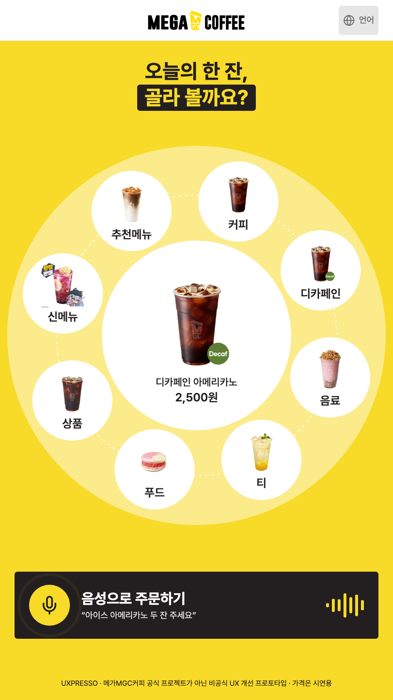
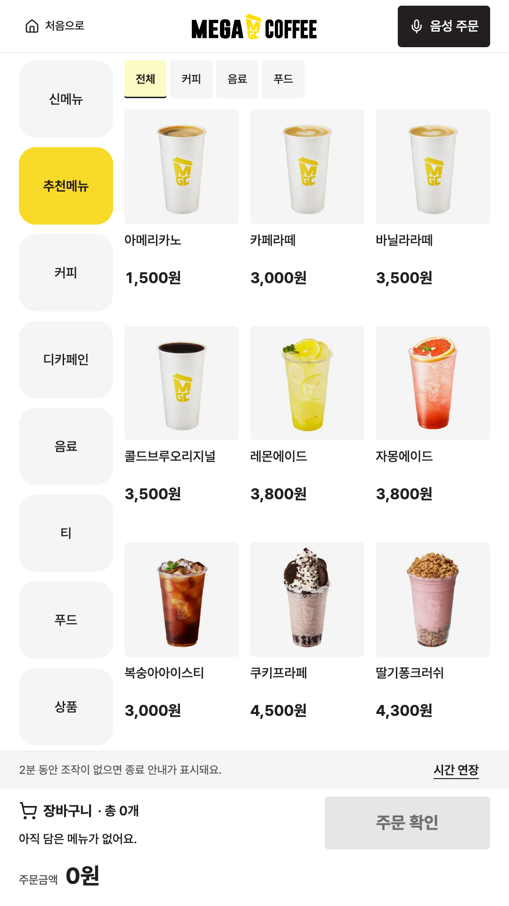
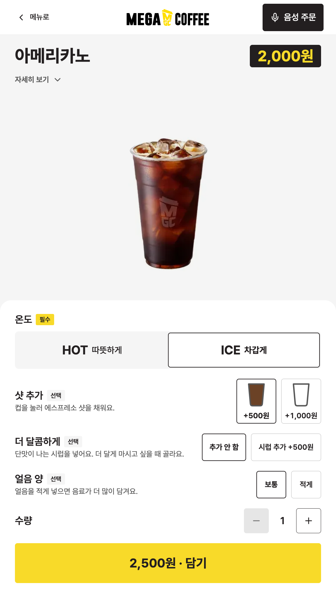
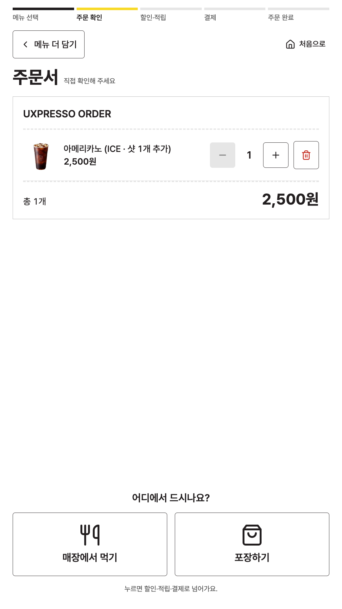
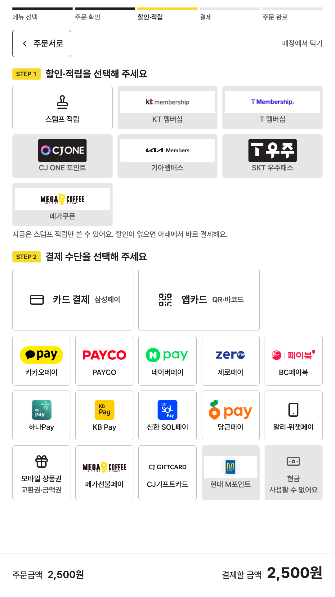
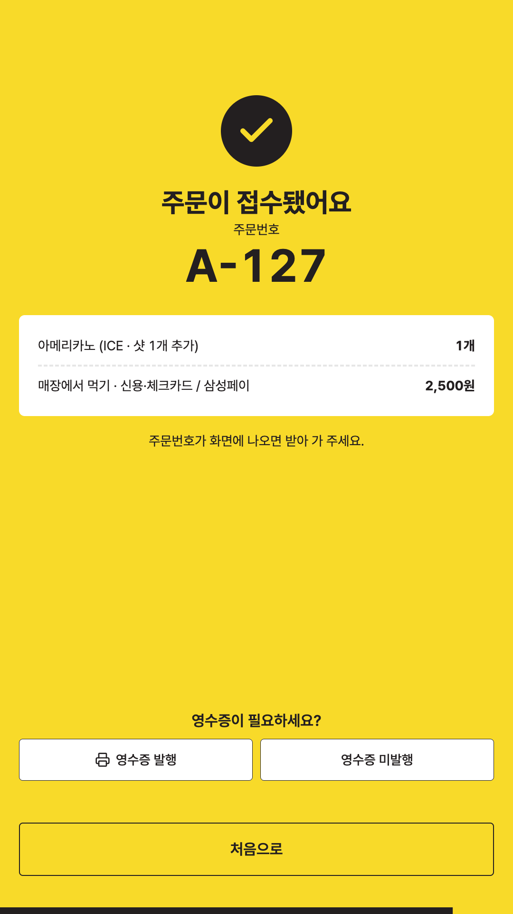

# 프로토타입 (현행: 키오스크 v6)

최종 서비스 화면입니다. 서버를 실행하고 `/`로 접속하면 `/v6/index.html`이 열립니다. 비공식 프로토타입이며 메뉴·가격·결제는 테스트 데이터입니다.

## 화면 흐름

```
시작(오비트 메인) ─┬→ 메뉴(카테고리·3열) → 상세·옵션(HOT/ICE·샷·수량) → 주문서(매장/포장 선택)
                  │      → 할인·적립 + 결제 수단 → 결제 처리 → 완료(주문번호·영수증 발행 여부)
                  └→ 음성으로 주문하기 (선택) → 같은 장바구니에 담김 → 주문서부터는 터치로 진행
```

| 시작 | 메뉴 | 옵션 | 주문서 | 결제 | 완료 |
|---|---|---|---|---|---|
|  |  |  |  |  |  |

화면 캡처는 발표 자료(designoh)에서 가져왔습니다.

## 화면별 핵심

- **시작:** 돌아가는 8개 메뉴, "음성으로 주문하기" 버튼
- **메뉴:** 왼쪽 카테고리 + 상단 서브메뉴 + 3열 카드, 하단 고정 장바구니(총액, 미사용 안내 문구)
- **상세·옵션:** HOT/ICE(텍스트 + 색), 필수/선택 표시, 추가 금액 바로 반영, 수량 최대 9
- **주문서:** 담은 메뉴 수정·삭제, 매장에서 먹기 / 포장하기 선택
- **결제:** STEP 1 할인·적립, STEP 2 결제 수단. 결제사 로고 표시, 쓸 수 없는 수단은 비활성
- **완료:** 주문번호, 영수증 발행 / 미발행
- **세션:** 120초 동안 조작이 없으면 종료 안내(실제 남은 초 표시), 60초 유예. 그 밖의 화면에는 카운트다운을 표시하지 않음
- **음성 주문(선택 기능):** Gemini Live. 서버가 메뉴 데이터로 먼저 검증한 뒤 화면 장바구니에 담고, AI는 실제 장바구니 결과를 받은 뒤에만 말합니다. 결제·쿠폰·적립은 음성으로 하지 않으며 주문서부터 마이크를 끕니다. 자세한 구조: [../api/ai-integration.md](../api/ai-integration.md)

## 코드

| 파일 | 역할 |
|---|---|
| `public/v6/index.html` · `app.js` · `style.css` | 화면·상태·인터랙션 (바닐라 JS) |
| `public/v6/menu-data.json` | 메뉴 192개(시연용 예시 가격). 이미지는 [../menu-image-links/](../menu-image-links/README.md)의 ImageKit 링크 |
| `public/v6/live-adapter.js` | 음성 주문을 v6 장바구니·화면 이동으로 연결 |
| `public/live-client.js` | 브라우저 음성 엔진(마이크·재생·WebSocket). v6가 `../live-client.js`로 불러옵니다 |
| `public/v6/pay/` · `logo.svg` | 결제사 로고, 로고 |

## 디자인 원본

| 자료 | 내용 |
|---|---|
| [v2-i/](v2-i/README.md) | v6 레이아웃의 원본 시안 v2-I — 캔버스 소스, 단독 실행 프로토타입(`prototype/`), Figma로 옮기기 좋은 HTML 화면 35장(`html/`), 메뉴 데이터 생성 도구 |
| [Figma 시안](https://www.figma.com/design/RPhFB3P8rftlJ1k0E9QmA7/UXPRESSO--%EC%9C%A0%EC%97%91%EC%8A%A4%ED%94%84%EB%A0%88%EC%86%8C-%ED%8C%80---%EC%B9%B4%ED%8E%98-%ED%82%A4%EC%98%A4%EC%8A%A4%ED%81%AC-%EA%B0%9C%EC%84%A0?node-id=0-1) | 팀 Figma 파일 (Figma 계정 필요) |
| [../design-system/](../design-system/README.md) | 현행 디자인 시스템 DS v6.0 |

이전 프로토타입(초기 키오스크, mega-ver.2 재구성 등): [../archive/prototypes/](../archive/prototypes/README.md)
